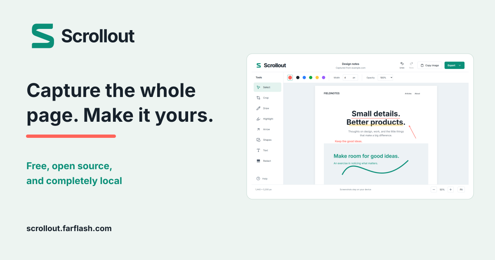

# Scrollout

**Capture the whole page. Make it yours.**

**Free, open source, and completely local.**

Scrollout is a free Chrome extension for full-page screenshots and local editing. Draw, crop, highlight, add arrows, shapes or text, cover sensitive areas, and export without a paywall. It has no account, backend, analytics, or upload service.

[Add to Chrome](https://chromewebstore.google.com/detail/scrollout/ajlhmigmaeodaedpgjmngkchnjoenmkm) - [Website](https://scrollout.farflash.com) - [Download v1.0.5](https://github.com/farflashgroup/Scrollout/releases/tag/v1.0.5) - [Guides](https://scrollout.farflash.com/guides/) - [Privacy](https://scrollout.farflash.com/privacy/) - [Press kit](https://scrollout.farflash.com/press/)



Scrollout 1.0.2 is public in the [Chrome Web Store](https://chromewebstore.google.com/detail/scrollout/ajlhmigmaeodaedpgjmngkchnjoenmkm), verified October 28, 2026. The newer 1.0.5 ZIP/source release improves capture speed and editor loading, including the panel-capture and editor-sizing fixes from 1.0.4 and update notices from 1.0.3. Version 1.0.4 was submitted for store review on October 28 with automatic publication after approval. The 1.0.5 download is separate from that pending store update.

## Install the ready-to-use extension

For the Chrome-managed installation, [open Scrollout in the Chrome Web Store](https://chromewebstore.google.com/detail/scrollout/ajlhmigmaeodaedpgjmngkchnjoenmkm), choose **Add to Chrome**, and pin Scrollout from the extensions menu.

For the unpacked/source edition, download [Scrollout-1.0.5.zip from the release](https://github.com/farflashgroup/Scrollout/releases/download/v1.0.5/Scrollout-1.0.5.zip) and extract it into a folder you will keep.

1. Open `chrome://extensions` in desktop Chrome 120 or newer.
2. Turn on **Developer mode**.
3. Choose **Load unpacked** and select the extracted folder (or `dist` if you built from source).
4. Open Chrome's extensions menu and pin **Scrollout**.

The distribution archive is `release/Scrollout-1.0.5.zip`. Extract it first, then load the extracted folder. Chrome does not install an unpacked extension directly from a ZIP.

The archive includes `INSTALL.md` with loading instructions and a short usage guide, along with the brand guide and third-party notices.
The separate `release/Scrollout-1.0.5-source.zip` contains the source, tests, and build scripts, without dependencies or generated test reports.

## Updates

Store installs use Chrome’s automatic update system; enterprise installs follow administrator policy. Unpacked installs get release notices and **Help → Updates**, including a manual check, download, and SHA-256 verification. Export and close your editors, replace the files in the same loaded folder with the new ZIP contents, then click **Reload** in `chrome://extensions`. Source installs require pulling and rebuilding first. Older 1.0.2 copies need one manual update to receive the checker. Reloading unchanged files does not update an unpacked installation.

Release checks fetch one static public JSON file at most every 12 hours while an editor is open. They send no screenshots, annotations, page URLs, filenames, cookies, credentials, or request body. Automatic checks can be disabled in Help; Chrome’s own update system is separate. Checks are bounded, cached, and optional; capture/edit/export still work offline. A downloaded Chrome update waits until capture and all extension pages have closed. No remote code is downloaded or executed by the checker.

Future releases: bump the package/manifest version, build and test, then run `node scripts/store-kit.mjs`, `node scripts/website.mjs`, and `node scripts/package-store.mjs`. Publish the matching ZIP and website together. The website generator writes `releases.json` and its CORS/no-store headers from the packaged version and hash. Set the published store URL only after verifying public installation; its version comes from the recorded published/submitted store version, so an unpacked release is never mistaken for an approved store update.

### Capture speed in 1.0.5

Panel dimensions now distinguish actual overflow from rounded CSSOM sizes. This avoids capturing a duplicate horizontal column at fractional zoom, and prevents a non-scrolling axis from shrinking the output dimensions. The worker reads native dimensions from the PNG header without decompressing each screenshot, batches fragments from one screenshot into one storage transaction, and the editor shares their decoded bitmap. Capture completion signals open the editor immediately, with polling retained as a fallback. Sticky style changes are batched after measurement to avoid repeated layout work.

In a synthetic 4,040 CSS-pixel virtualized list at 130% Chrome zoom, 1.0.4 used 18 screenshots and took 10.804 seconds; 1.0.5 used nine and took 5.174 seconds on the same Windows/Chrome 156 setup. This is approximately 52% less time for that rounding-affected case. At 100% zoom, both used seven screenshots and took about four seconds. These are internal measurements, not a general speed guarantee. [Chrome limits this screenshot API to two calls per second](https://developer.chrome.com/docs/extensions/reference/api/tabs#property-MAX_CAPTURE_VISIBLE_TAB_CALLS_PER_SECOND); Scrollout keeps its minimum 550 ms spacing and full-resolution PNG capture.

On October 28, 2026, all 31 unit checks and 46 browser checks passed on Windows with Chrome 156.0.8078.47. New regressions verify 125% and 130% vertical panel captures use one column, reach the last virtualized row, restore scrolling, and maintain at least 550 ms between native screenshot calls. Completion notification is tested with background polling suspended. Unit checks cover PNG dimensions/bytes and shared bitmap decoding; existing export, redaction, ownership, CSP, interruption, and update tests also pass. The full dependency audit found zero known vulnerabilities. Chrome 120 remains the build target; these new performance changes have not been runtime-tested on Chrome 120.

### Historical validation of 1.0.4

On October 28, 2026, all 27 unit checks and 43 browser checks passed on Windows with Chrome 156.0.8078.47. New coverage verifies both axes of a main app panel, final-tile pixels, virtualized rows, cancellation and exact scroll restoration, and 125% browser zoom with 2x display scaling and fractional borders/padding. The editor regression checks initial fit against the measured workspace and stable canvas dimensions, pixels, and scroll offsets at fractional sizes. Existing checks cover drawing, crop coordinates, undo/redo, PNG/JPEG/PDF/clipboard redaction, oversized exports, temporary ownership, malformed messages, CSP, and safe update handling. The full dependency audit found zero known vulnerabilities.

Tests use synthetic fixtures, without real guest or customer data. Chrome 120 remains the build target; these new panel and sizing fixes have not been runtime-tested on Chrome 120. A large, fully visible main panel is selected only when the document itself does not scroll; other nested widgets and embedded frames retain their visible contents.

### Historical validation of 1.0.3

On October 21, 2026, 24 unit checks passed and 39 distinct browser checks were verified across a full Chromium 153.0.8010.12 run and targeted Chrome 155.0.8059.79 reruns. The initial 36-test run passed 33 checks; three test-profile startup cases passed the targeted rerun. Nine update integration checks cover unpacked/browser/managed guidance, exact metadata requests with the production permissions, caching and opt-out, offline and malformed responses, unavailable preference storage, pending-update deferral with duplicate editors, native update throttling, and narrow windows. Production-dependency audit found no known vulnerabilities. This is internal regression QA.

A fresh Chrome 120 executable could not launch in this environment during that QA pass; the new update flows were not runtime-tested on 120. The build remains targeted at Chrome 120, and the historical 1.0.2 compatibility results below remain separate.

When port 4173 is occupied, set `SCROLLOUT_QA_PORT` to a free test port. The fixture server and all test contexts use that same port.

## Capture and edit

Open a website and click Scrollout. Keep the source tab active while it scrolls. The icon shows progress; when capture completes, the editor opens automatically. Click the icon again or press Escape on the source page to cancel.
If the icon shows **!**, hover over it for the failure details.

- **Select:** click an annotation, drag to move it, or drag its bottom-right handle to resize. Double-click text to edit it. Delete removes the selection.
- **Crop:** drag a rectangle, then choose **Apply crop** or press Enter.
- **Draw / Highlight / Arrow:** drag on the screenshot. Use the property bar to change color, width, and opacity.
- **Shapes:** choose a rectangle or ellipse in the property bar and drag.
- **Text:** click, type, and press Enter to finish; Shift+Enter adds a line.
- **Redact:** drag an opaque black rectangle. Exported pixels are flattened; covered image data is not embedded in exported files. The original remains available for undo only while the editor session is open.

PNG preserves full quality. JPEG uses 92% quality. PDF fits the screenshot to A4 pages at up to 144 DPI. Very large PNG/JPEG images are split into numbered parts inside one ZIP, with `parts.json` describing their arrangement. Copy image writes a flattened PNG to the clipboard; oversized images need to be exported instead.

| Shortcut | Action |
| --- | --- |
| V / C / D / H | Select / Crop / Draw / Highlight |
| A / S / T / R | Arrow / Shapes / Text / Redact |
| Ctrl/⌘ Z | Undo |
| Ctrl/⌘ Shift Z | Redo |
| Delete | Delete the selected annotation |
| Escape | Cancel crop or selection; cancel capture on the source page |

## Privacy and temporary sessions

All processing happens locally. The extension requests `activeTab`, `scripting`, `storage`, and `clipboardWrite`; it does not request persistent access to all websites.

Image tiles and edits are temporarily held in the extension's IndexedDB. A reload of an open editor preserves its latest saved edits. Closing or navigating away from the last editor for a capture deletes that capture. A browser restart expires temporary sessions; restored editor tabs will ask you to capture again. Export anything you want to keep. Chrome extension reloads also expire sessions.

## Capture boundaries

- Capture covers the document length present when you start. Lazy images within that region can load; an infinite feed is not extended indefinitely.
- When the document itself does not scroll, Scrollout automatically captures a large, fully visible main scrolling panel, across both axes. Other panels, small widgets, and embedded frames retain their visible contents. Virtualized lists are captured as their rows appear during scrolling.
- Chrome-owned pages, the Chrome Web Store, some PDF viewers, and other protected pages may disallow full-page capture. Local files require Chrome's **Allow access to file URLs** setting.
- Changing tabs, manually scrolling, resizing the viewport, or navigating cancels an active capture and restores the source page.
- Fixed overlays appear once; sticky elements are temporarily returned to their normal flow. Responsive or continuously changing pages may need another capture after they settle.

## Development

Use the latest patched Node.js 24 LTS (at least 24.22.1) and npm. Node.js 26.12.1+ in the 26.x line is also supported. `.node-version` selects the 24.x line, and `engine-strict` rejects older, unpatched runtimes during dependency installation.

```sh
npm ci
npm run dev
npm run typecheck
npm test
npm run build:check
npm run security
npx playwright install chromium
npm run test:e2e
npm run security:site
```

Open `http://127.0.0.1:4173/editor.html?demo=1` for the development-only sample editor. The sample is never loaded in the extension. Build regenerates the branded icons, bundles the editor and capture scripts, and writes both `dist/` and the distribution ZIP.

`build:check` rebuilds `dist/` for validation while preserving published ZIPs. Use `npm run build` to package a new release after bumping its version. The development and preview servers bind to loopback, disable cross-origin access, and restrict filesystem reads.

The unit tests check source-pixel geometry, hit testing, export splitting, message validation, and permission/CSP contracts. Browser tests verify editing, actual exported image pixels, PDF downloads, narrow layouts, and the MV3 capture pipeline. The fault-injection tests use an isolated test copy with host permissions and a test-only worker entrypoint. The production security tests load the unmodified distribution. On recent Chrome releases, action tests use `Extensions.triggerAction` to grant `activeTab` through the real extension action; Chrome 120 uses native input as described below. The distributed manifest remains minimal. Test profiles never use your normal browser profile.

Playwright Chromium is the default for repeatable browser tests. Set `SCROLLOUT_QA_CHROME` to a Chrome executable's full path to run **all** editor, capture, and security contexts in that browser. Every extension test creates and removes its own temporary profile. Capture tests use the native browser window and native display scaling: Chrome 120's screenshot API does not honor a CDP-emulated viewport. The editor and both extension scripts explicitly target Chrome 120 in the production build.

Recent Chrome releases support `Extensions.loadUnpacked` and `Extensions.triggerAction`, so the complete suite runs from the command line. For Chrome 120, the production ownership/CSP tests load the same unmodified `dist` through Chrome's startup flag. The two production action tests require native input because Chrome 120 has no action-invocation CDP command. Set `SCROLLOUT_QA_ACTION_FILE` to a temporary JSON filename to enable the native-input bridge and visible isolated windows. Each request identifies a unique window title and request ID; a native controller activates Scrollout in that window, then marks that matching request `done: true`. Chrome's existing `_execute_action` shortcut is assigned Ctrl+Shift+Y only in the temporary test profile. No production manifest changes or host permissions are used. Without a native controller, run the other 28 browser checks with `npx playwright test -g "^(?!.*(?:initial storage failure|native Chrome action))"`.

Chrome 120.0.6099.109 is available from Google's [Chrome for Testing archive](https://googlechromelabs.github.io/chrome-for-testing/). Use a separate browser folder and profile rather than replacing your installed Chrome.

## Security checks

Redaction removes covered source pixels before resampling and covers every touched output pixel. Regression tests change the hidden source image and verify identical redacted PNG, JPEG, clipboard, and PDF image data. Temporary-session tests cover reload, duplicate editors, navigation, closing the last editor, and browser-session expiry. Worker interruption and orphan cleanup stop capture and restore the source page. Initial storage failures show an action error before any source-page changes. Worker messages require valid payloads and the appropriate sender, top frame, document, and capture ID. The extension CSP restricts remote resources, frames, embedded objects, scripts, forms, and base URLs.

These checks cover the extension's local trust boundaries and exports. They do not constitute an independent penetration test or verification of every supported Chrome version.

GitHub runs dependency, artifact, website transport/CSP, and browser security checks on changes and weekly. Dependabot security updates, CodeQL, secret scanning, and secret push protection are enabled. Actions use pinned commit SHAs and a read-only job token. See [SECURITY.md](SECURITY.md) for the dated assessment and reporting contact.

## Chrome 120 compatibility in 1.0.2

Chrome 120's PDF downsampling could blend covered source pixels past an output-space redaction edge. Version 1.0.2 masks the original image pixels before resampling, using bounded temporary canvases, then reapplies the opaque output mask. Regression checks compare exports from different hidden source colors and exercise fractional crops, tile boundaries, source offsets, small scales, and unchanged original tiles after removing a redaction.

Capture also retains fractional visual-viewport dimensions and reconciles the native bitmap with the browser's pixel ratio within CSS rounding limits. This avoids accumulated size distortion at fractional browser zoom while preserving the bitmap-derived fallback for emulated displays.

Loading-status events are checked against the original running document, so resource loads and delayed initial-load events do not incorrectly cancel a capture. Actual navigation, including reloading the same URL, still cancels. Capture commands are bound to the injected document ID as well as the source tab and frame.

On October 19, 2026, all 30 browser checks were verified on Windows with Chrome for Testing 120.0.6099.109 and installed Chrome 155.0.8059.79, including native extension-action invocation with the unmodified production permissions. All 13 unit tests passed, and npm audit reported zero known dependency vulnerabilities. Checks cover both-axis stitching, final tiles, lazy images, page restoration, cancellation, worker interruption, storage failures, zoom, native 2× display scaling, all editing tools, crop/undo coordinates, large ZIP exports, clipboard/PDF/image output, opaque redaction pixels, CSP, sender validation, and temporary ownership. The editor build target is pinned to Chrome 120 to preserve the declared minimum when build-tool defaults change.

## Project structure

- `src/extension`: capture orchestration, page scrolling, cancellation, and cleanup.
- `src/editor`: React interface, viewport rendering, tools, history, and exports.
- `src/shared`: typed documents, tile geometry, and temporary storage.
- `public/brand`: SVG/PNG branding and Chrome toolbar icons.
- `scripts`: deterministic brand generation and packaging.
- `tests`: unit tests, editor tests, and isolated extension integration tests.

See [the brand guide](BRAND.md) for logo usage and design tokens. Bundled Inter fonts retain their SIL Open Font License in the brand assets.

## Chrome Web Store preparation and website

The submission materials are in `store/`. Open `store/START-HERE.html` for copyable listing text, permission explanations, reviewer instructions, and previews of all store graphics. `store/submission-checklist.md` lists account steps and the exact extension ZIP to upload. The store-kit ZIP is a preparation bundle, not an extension upload.

The public landing page, privacy policy, support, guides, and press kit are in `website/`, deployed at `https://scrollout.farflash.com`. The site has no account system, added analytics, or remote fonts/scripts. It offers the tested extension ZIP until `store/publisher.json` contains the live Chrome Web Store URL. Hosting request logs are disclosed separately from the extension's local screenshot processing.

Public editorial content lives in `scripts/guide-content.mjs`. The guide renderer generates canonical links, Article and BreadcrumbList metadata, and the sitemap. JSON-LD scripts use exact CSP hashes. `marketing/` holds launch copy and the submission tracker; it is source documentation, not part of the deployed website. `store/START-HERE.html` is also excluded from the public deployment.

```sh
node scripts/store-kit.mjs
# With npm run dev already serving on port 4173:
node scripts/store-screenshots.mjs
node scripts/marketing-assets.mjs
node scripts/website.mjs
node scripts/package-store.mjs
# Optional local website preview on port 4174:
node scripts/serve-website.mjs
```

Publisher identity and contact values are in `store/publisher.json`. Regenerate and verify the pages and listing files after changing them. Current website deployment and DNS status are recorded in `store/deployment.md`.

## Open source

Scrollout is licensed under the [MIT License](LICENSE), copyright 2026 FarFlash Group Ltd. The public repository is [farflashgroup/Scrollout](https://github.com/farflashgroup/Scrollout). Bundled fonts and third-party dependencies retain the licenses listed in [THIRD_PARTY_NOTICES.md](THIRD_PARTY_NOTICES.md).

See [CONTRIBUTING.md](CONTRIBUTING.md) for development guidance and [SECURITY.md](SECURITY.md) for private vulnerability reports.
